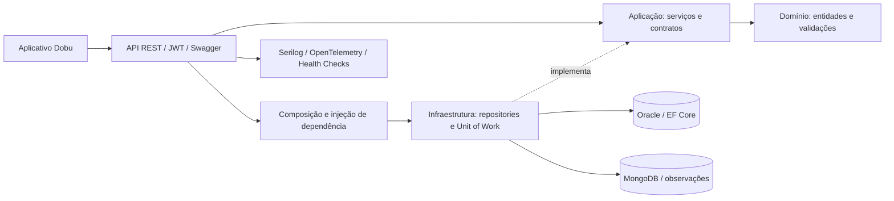

# Sprint 4 Challenge | DOBU

## Integrantes do Grupo

| Nome | RM |
| --- | --- |
| Amandha Yumi Toyota Artulino | 563549 |
| Erick Takeshi Andrade Nakajune | 566059 |
| Giovanna Bardella Gomes | 561439 |

---

## Domínio do Projeto

A DOBU API é uma API de gerenciamento veterinário inteligente.

A aplicação centraliza o controle de usuários, pets, espécies, raças, consultas, agendamentos, prontuários, vacinas, pagamentos, lembretes, DobuCam, análises com IA e logs de erro. O projeto foi organizado em camadas seguindo uma Clean Architecture, com contratos na Aplicação e implementações na Infraestrutura.

Repositório: <https://github.com/DobuChallenge/Dobu-Sprint4.NET>

---

## Consolidação da Sprint 4

As rotas e os CRUDs anteriores foram mantidos. Esta versão adiciona consulta paginada, busca, ordenação, navegação HATEOAS, conversa dos agendamentos e histórico de observações da Dobu-Cam no MongoDB.

| Requisito | Implementação e conferência |
| --- | --- |
| Arquitetura | Domínio independente; serviços e contratos na Aplicação; EF Core/MongoDB na Infraestrutura; controllers REST e DI na API. Criação/edição de pets e agendamentos, conversa e observações passam por serviços. |
| API | JWT, Swagger exportado, filtros, paginação e ordenação no banco; links HATEOAS nos cabeçalhos HTTP. |
| Relacional | Oracle com migrations preservadas e migração de mensagens; aplicação automática configurável e teste em schema isolado. Migrations e persistência foram validadas em Oracle real no CI; configurar a conexão local da equipe ainda é necessário. |
| NoSQL | Inserção, consulta e exclusão reais de observações no MongoDB, com índice por câmera/data e checagem de acesso ao animal. |
| Monitoramento | Health checks da API, banco relacional, MongoDB e serviço externo; Serilog, correlação, tracing e métricas Prometheus. |
| Testes | xUnit com AAA; integração HTTP, MongoDB real e teste Oracle condicional para schema isolado. CI executou os 39 testes com Oracle e MongoDB reais, sem ignorados. |
| Documentação | Rotas, instalação, migrations, testes, integrantes, diagrama e OpenAPI exportado neste repositório. |

### Diagrama da solução



### Paginação, ordenação e filtros

```http
GET /api/pets?page=1&pageSize=20&sort=nome&descending=false&search=lua
GET /api/agendamentos?page=1&pageSize=10&status=CONFIRMADO
```

`page` começa em 1; `pageSize` aceita de 1 a 100 e usa 20 quando omitido junto de `page`. `sort` aceita campos escalares públicos da entidade, exceto senha; `search` pesquisa campos de texto sem consultar senhas. Filtros `petId`, `responsavelId` e `veterinarioId` são aceitos quando o campo existe na entidade. Campos inválidos retornam 400.

Sem `page` e `pageSize`, a lista completa é preservada para compatibilidade com o mobile. A resposta continua sendo um array; `X-Total-Count` informa o total antes da paginação. O cabeçalho `Link` fornece `self`, `collection`, `first`, `last`, `prev` e `next` quando aplicáveis. As consultas individuais também têm `self` e `collection`. Isso permite navegação HATEOAS sem alterar o JSON esperado pelo aplicativo.

### Conversa e confirmação do atendimento

- `GET /api/agendamentos/{agendamentoId}/chat`
- `POST /api/agendamentos/{agendamentoId}/chat` com `{ "texto": "Olá", "tipo": "MENSAGEM" }`
- Para confirmar, envie `tipo: "CONFIRMACAO"`. Uma confirmação por participante é mantida; após as duas confirmações, o agendamento fica `CONFIRMADO`.
- Somente o responsável pelo animal e o veterinário do agendamento acessam a conversa.

### Caderno de cuidados

- `GET /api/informacoes-cuidado/pet/{petId}`
- `POST /api/informacoes-cuidado` com `{ "titulo", "descricao", "petId" }`
- `DELETE /api/informacoes-cuidado/{id}`

### Observações da Dobu-Cam no MongoDB

- `GET /api/dobucams/{cameraId}/eventos?page=1&pageSize=20&tipo=HIDRATACAO`
- `GET /api/dobucams/{cameraId}/eventos/{id}`
- `POST /api/dobucams/{cameraId}/eventos`
- `DELETE /api/dobucams/{cameraId}/eventos/{id}`

```json
{
  "tipo": "HIDRATACAO",
  "descricao": "Possível interação junto ao pote de água",
  "data": "2026-11-04T10:00:00Z",
  "confianca": 0.8
}
```

A API guarda observações recebidas; este endpoint não executa visão computacional nem comprova consumo. Tipos: `PRESENCA`, `MOVIMENTO`, `ALIMENTACAO`, `HIDRATACAO`, `DESCANSO`. Confiança é opcional, entre 0 e 1. A câmera deve pertencer ao responsável autenticado. A ordenação do histórico usa `timestamp` e aceita `descending=true`; `tipo` e `search` filtram os registros. Os dados ficam no MongoDB, separados das entidades relacionais.

### Testes e cobertura da versão

Na verificação local, passaram **20 testes unitários e 18 de integração**, incluindo MongoDB real e o fluxo HTTP completo. Os dois testes de integração do mobile também passaram contra esta API na porta 5100. No GitHub Actions passaram **39 testes sem ignorados**, incluindo a aplicação das migrations e persistência em Oracle isolado: [execução validada](https://github.com/DobuChallenge/Dobu-Sprint4.NET/actions/runs/41776850019). No computador local, o teste Oracle é ignorado enquanto a connection string da equipe não estiver configurada.

Cobertura consolidada por linha de Domínio e Aplicação, unindo os relatórios unitários e de integração: **89,46% em Domínio** e **91,86% em Aplicação**. Os números estão em [docs/cobertura.json](docs/cobertura.json). O limite interno do workflow é 80% por camada; o enunciado recebido não informa percentual numérico.

```powershell
$env:DOBU_TEST_MONGO_URL = 'mongodb://127.0.0.1:27017'
$resultados = Join-Path 'TestResults' ([guid]::NewGuid().ToString('N'))
dotnet test DOBU/Dobu.sln --collect:"XPlat Code Coverage" --results-directory $resultados
python scripts/coverage.py $resultados --minimum 80
```

Sem `DOBU_TEST_MONGO_URL`, o teste MongoDB é explicitamente ignorado. Os demais testes HTTP usam SQLite temporário isolado; isso não comprova compatibilidade ou migrations aplicadas no Oracle. Para o teste Oracle, use um schema exclusivo de testes:

```powershell
$env:DOBU_TEST_ORACLE = $env:ConnectionStrings__DobuOracle
$env:DOBU_TEST_ORACLE_ISOLATED = 'true'
dotnet test DOBU/Dobu.sln --filter FullyQualifiedName~OraclePersistenceTests
```

Esse teste aplica migrations no schema informado e faz rollback dos registros de teste. Não aponte para um schema compartilhado de produção. O [workflow de testes](.github/workflows/dotnet.yml) prepara bancos isolados no GitHub Actions; a execução validada acima comprova a aplicação em Oracle isolado, sem afirmar que o schema da faculdade foi alterado.

### Bancos locais com Docker

Quem já tiver Oracle da faculdade pode usar essa conexão diretamente. Para criar bancos locais, com Docker disponível:

```powershell
$env:ORACLE_ADMIN_PASSWORD = 'SUA_SENHA_ADMIN_LOCAL'
$env:DOBU_ORACLE_PASSWORD = 'SUA_SENHA_DO_USUARIO_LOCAL'
docker compose up -d
```

O `compose.yml` usa volumes persistentes e publica as portas somente em `127.0.0.1`. Para esse Oracle local, a conexão é `User Id=dobu;Password=SUA_SENHA_DO_USUARIO_LOCAL;Data Source=localhost:1521/FREEPDB1`. As senhas são fornecidas pelo ambiente.

---

## Objetivo desta Entrega

Esta entrega corresponde à Sprint 4 de Advanced Business Development with .NET do Challenge, com foco em:

- API RESTful com ASP.NET Core Web API
- CRUD completo
- rotas parametrizadas
- retornos HTTP corretos
- persistência com Entity Framework Core
- integração com Oracle Database
- mapeamentos com Fluent API
- migrations versionadas
- contratos e implementações de repositories
- injeção de dependência
- documentação com Swagger/OpenAPI
- monitoramento com Health Checks
- logging estruturado e correlação de requisições
- distributed tracing e métricas com OpenTelemetry
- testes unitários e de integração automatizados
- cobertura de testes e organização por camadas

---

## Tecnologias Utilizadas

- .NET 9
- ASP.NET Core Web API
- Entity Framework Core
- Oracle Entity Framework Core Provider
- Oracle Database e MongoDB
- Swagger / OpenAPI
- Serilog
- OpenTelemetry e Prometheus
- xUnit, Moq e WebApplicationFactory

---

## Estrutura da Solução

- `Dobu.Domain`: entidades e regras centrais do domínio.
- `Dobu.Application`: contratos da aplicação, incluindo interfaces de repositories.
- `Dobu.Infrastructure`: `DobuDbContext`, Fluent API, migrations e repositories concretos.
- `Dobu.Api`: controllers, rotas REST, Swagger/OpenAPI e configuração de DI.
- `docs`: evidências da modelagem e documentação complementar.

---

## Entidades Modeladas

- Usuario
- Especie
- Raca
- Pet
- Consulta
- Agendamento
- Prontuario
- Vacina
- Pagamento
- Lembrete
- DobuCam
- AnaliseIa
- LogErro

---

## Persistência com EF Core

A persistência foi implementada na camada `Dobu.Infrastructure`, contendo:

- `DobuDbContext`
- `DbSet` para as entidades do domínio
- configurações com `IEntityTypeConfiguration`
- `ApplyConfigurationsFromAssembly`
- mapeamentos com Fluent API
- migration inicial `InitialDobu`
- repositories concretos

---

## Banco de Dados Utilizado

O SGBD utilizado neste projeto é:

**Oracle Database**

---

## Repositories

As interfaces dos repositories ficam em:

```text
DOBU/Dobu.Application/Interfaces/Repositories
```

As implementações ficam em:

```text
DOBU/Dobu.Infrastructure/Repositories
```

Repositories disponíveis:

- `IAgendamentoRepository`
- `IAnaliseIaRepository`
- `IConsultaRepository`
- `IDobuCamRepository`
- `IEspecieRepository`
- `ILembreteRepository`
- `ILogErroRepository`
- `IPagamentoRepository`
- `IPetRepository`
- `IProntuarioRepository`
- `IRacaRepository`
- `IUsuarioRepository`
- `IVacinaRepository`

Os contratos das sprints anteriores foram preservados. Os controllers atuais utilizam `IDobuUnitOfWork` e `IEntityRepository<T>`, com operações assíncronas e consultas filtradas/paginadas no banco. `EntityRepository<T>` e `DobuUnitOfWork` são as implementações EF Core. O histórico de observações usa `ICameraObservationRepository`, implementado com o driver MongoDB.

---

## Injeção de Dependência

O registro de dependências é feito no projeto da API por meio de:

```csharp
builder.Services.AddPersistence(builder.Configuration);
```

Esse método chama:

```csharp
services.AddInfrastructure(configuration);
```

Na Infrastructure são registrados o `DobuDbContext` com Oracle e todos os repositories no container de injeção de dependência.

---

## Configuração Segura

O `appsettings.json` não contém senha, chave JWT ou connection string fixa. Em produção, configure esses valores nas configurações seguras do Azure App Service:

```text
ASPNETCORE_ENVIRONMENT=Production
Database__Provider=Oracle
Database__ApplyMigrations=true
Mongo__Enabled=true
Mongo__ConnectionString=mongodb://localhost:27017
Mongo__Database=dobu
ConnectionStrings__DobuOracle=User Id=SEU_USUARIO;Password=SUA_SENHA;Data Source=oracle.fiap.com.br:1521/orcl
Jwt__Key=CHAVE_COM_PELO_MENOS_32_CARACTERES
Observability__ExternalServiceUrl=https://servico-externo/health
```

Para desenvolvimento local, o projeto usa SQLite pelo `appsettings.Development.json`.

---

## Documentação OpenAPI

O Swagger/OpenAPI está configurado na API. A especificação exportada desta versão está em [docs/openapi.json](docs/openapi.json).

Com a aplicação em execução, acesse:

```text
http://localhost:5070/swagger
```

Pela interface é possível visualizar os endpoints, conferir parâmetros e testar requisições.

---

## Documentação das Rotas

### Agendamentos

| Método | Rota |
| --- | --- |
| GET | `/api/agendamentos` |
| GET | `/api/agendamentos/{id}` |
| GET | `/api/agendamentos/pet/{petId}` |
| GET | `/api/agendamentos/veterinario/{veterinarioId}` |
| GET | `/api/agendamentos/status/{status}` |
| POST | `/api/agendamentos` |
| PUT | `/api/agendamentos/{id}` |
| DELETE | `/api/agendamentos/{id}` |

### Análises IA

| Método | Rota |
| --- | --- |
| GET | `/api/analises-ia` |
| GET | `/api/analises-ia/{id}` |
| GET | `/api/analises-ia/prontuario/{prontuarioId}` |
| GET | `/api/analises-ia/risco/{risco}` |
| POST | `/api/analises-ia` |
| PUT | `/api/analises-ia/{id}` |
| DELETE | `/api/analises-ia/{id}` |

### Consultas

| Método | Rota |
| --- | --- |
| GET | `/api/consultas` |
| GET | `/api/consultas/{id}` |
| GET | `/api/consultas/pet/{petId}` |
| GET | `/api/consultas/veterinario/{veterinarioId}` |
| GET | `/api/consultas/periodo?inicio=2026-05-01&fim=2026-05-31` |
| POST | `/api/consultas` |
| PUT | `/api/consultas/{id}` |
| DELETE | `/api/consultas/{id}` |

### DobuCams

| Método | Rota |
| --- | --- |
| GET | `/api/dobucams` |
| GET | `/api/dobucams/{id}` |
| GET | `/api/dobucams/pet/{petId}` |
| GET | `/api/dobucams/status/{statusCamera}` |
| POST | `/api/dobucams` |
| PUT | `/api/dobucams/{id}` |
| DELETE | `/api/dobucams/{id}` |

### Espécies

| Método | Rota |
| --- | --- |
| GET | `/api/especies` |
| GET | `/api/especies/{id}` |
| GET | `/api/especies/nome/{nome}` |
| POST | `/api/especies` |
| PUT | `/api/especies/{id}` |
| DELETE | `/api/especies/{id}` |

### Lembretes

| Método | Rota |
| --- | --- |
| GET | `/api/lembretes` |
| GET | `/api/lembretes/{id}` |
| GET | `/api/lembretes/pet/{petId}` |
| GET | `/api/lembretes/status/{status}` |
| POST | `/api/lembretes` |
| PUT | `/api/lembretes/{id}` |
| DELETE | `/api/lembretes/{id}` |

### Logs de Erro

| Método | Rota |
| --- | --- |
| GET | `/api/logs-erro` |
| GET | `/api/logs-erro/{id}` |
| GET | `/api/logs-erro/usuario/{usuarioId}` |
| GET | `/api/logs-erro/procedure/{nomeProcedure}` |
| POST | `/api/logs-erro` |
| PUT | `/api/logs-erro/{id}` |
| DELETE | `/api/logs-erro/{id}` |

### Pagamentos

| Método | Rota |
| --- | --- |
| GET | `/api/pagamentos` |
| GET | `/api/pagamentos/{id}` |
| GET | `/api/pagamentos/consulta/{consultaId}` |
| GET | `/api/pagamentos/forma/{formaPagamento}` |
| POST | `/api/pagamentos` |
| PUT | `/api/pagamentos/{id}` |
| DELETE | `/api/pagamentos/{id}` |

### Pets

| Método | Rota |
| --- | --- |
| GET | `/api/pets` |
| GET | `/api/pets/{id}` |
| GET | `/api/pets/responsavel/{responsavelId}` |
| GET | `/api/pets/raca/{racaId}` |
| GET | `/api/pets/nome/{nome}` |
| POST | `/api/pets` |
| PUT | `/api/pets/{id}` |
| DELETE | `/api/pets/{id}` |

### Prontuários

| Método | Rota |
| --- | --- |
| GET | `/api/prontuarios` |
| GET | `/api/prontuarios/{id}` |
| GET | `/api/prontuarios/consulta/{consultaId}` |
| POST | `/api/prontuarios` |
| PUT | `/api/prontuarios/{id}` |
| DELETE | `/api/prontuarios/{id}` |

### Raças

| Método | Rota |
| --- | --- |
| GET | `/api/racas` |
| GET | `/api/racas/{id}` |
| GET | `/api/racas/especie/{especieId}` |
| GET | `/api/racas/porte/{porte}` |
| POST | `/api/racas` |
| PUT | `/api/racas/{id}` |
| DELETE | `/api/racas/{id}` |

### Usuários

| Método | Rota |
| --- | --- |
| GET | `/api/usuarios` |
| GET | `/api/usuarios/{id}` |
| GET | `/api/usuarios/tipo/{tipoUsuario}` |
| GET | `/api/usuarios/email/{email}` |
| POST | `/api/usuarios` |
| PUT | `/api/usuarios/{id}` |
| DELETE | `/api/usuarios/{id}` |

### Vacinas

| Método | Rota |
| --- | --- |
| GET | `/api/vacinas` |
| GET | `/api/vacinas/{id}` |
| GET | `/api/vacinas/pet/{petId}` |
| GET | `/api/vacinas/proxima-dose?ate=2026-05-31` |
| POST | `/api/vacinas` |
| PUT | `/api/vacinas/{id}` |
| DELETE | `/api/vacinas/{id}` |

---

## Retornos HTTP Utilizados

| Código | Descrição |
| --- | --- |
| 200 OK | Operação realizada com sucesso |
| 201 Created | Recurso criado com sucesso |
| 204 NoContent | Recurso removido com sucesso |
| 400 BadRequest | Dados inválidos |
| 404 NotFound | Recurso não encontrado |

---

## Migrations

A solução contém migration versionada para criação inicial do schema do banco.

Gerar uma nova migration:

```bash
dotnet ef migrations add NomeDaMigration --project DOBU/Dobu.Infrastructure --startup-project DOBU/Dobu.Api
```

Aplicar migrations:

```bash
dotnet ef database update --project DOBU/Dobu.Infrastructure --startup-project DOBU/Dobu.Api
```

---

## Evidências

As evidências complementares ficam na pasta `/docs`, incluindo:

- modelo relacional
- MER
- esquema físico

---

---

## Monitoramento, Observabilidade e Testes

A aplicação consolida na Sprint 4 com os seguintes recursos:

- Health Checks da API, do banco configurado e de serviço externo.
- Logging estruturado com Serilog nos níveis Information, Warning e Error, com saída para console e arquivo.
- Correlation ID por requisição usando o header `X-Correlation-ID`.
- Distributed tracing com OpenTelemetry entre API, HTTP client e camada de aplicação.
- Endpoint de métricas no formato Prometheus.
- Testes unitários com xUnit, Moq e padrão AAA.
- Testes de integração HTTP com `WebApplicationFactory`.
- Teste de integração do CRUD principal com fluxo `POST -> GET -> PUT -> DELETE`.
- Fixtures e Collection Fixture para compartilhar o contexto dos testes.
- Swagger configurado com autenticação JWT Bearer.
- Senhas armazenadas com hash e atualização/exclusão de usuário restrita ao próprio cadastro autenticado.

### Health Checks

- `GET /health`: verifica se a API está respondendo.
- `GET /health/ready`: verifica Oracle/SQLite, MongoDB e o serviço externo. O MongoDB é incluído quando `Mongo__Enabled=true`.
- `GET /metrics`: expõe métricas Prometheus, incluindo duração de resposta e total de erros HTTP.

O endpoint `/health/ready` retorna HTTP `200` quando as dependências estão saudáveis e HTTP `503` quando alguma dependência está indisponível.

O serviço externo é configurado pela variável `Observability__ExternalServiceUrl`.

### Logs e correlação

Os logs estruturados são enviados para o console e para:

```text
DOBU/Dobu.Api/logs/dobu-YYYYMMDD.log
```

Cada requisição recebe um identificador de correlação. Se o cliente enviar `X-Correlation-ID`, o mesmo valor será devolvido na resposta e aparecerá nos logs da requisição.

### Testes automatizados

Os testes estão separados em:

- `DOBU/tests/Dobu.UnitTests`: testes de domínio e aplicação.
- `DOBU/tests/Dobu.IntegrationTests`: testes HTTP com a API executando em memória.

Os testes de integração validam autenticação, endpoints de monitoramento, tratamento de erro e um fluxo completo do CRUD principal, criando e removendo usuários, pets, espécie, raça, consulta, agendamento, prontuário, vacina, pagamento, lembrete, DobuCam, análise e informação de cuidado.

Os testes seguem o padrão AAA:

1. Arrange: preparação dos dados e dependências.
2. Act: execução do método ou requisição.
3. Assert: validação do resultado esperado.

---

## Como Executar o Projeto

### Pré-requisitos

- .NET SDK 9 instalado.
- Acesso de rede a um schema Oracle.
- MongoDB 8 disponível localmente ou por connection string.
- Python 3 apenas para consolidar a cobertura, se desejar reproduzir o relatório.
- JetBrains Rider, Visual Studio ou VS Code com suporte a .NET.
- Credenciais do Oracle configuradas localmente.

Para conferir o SDK:

```powershell
dotnet --version
```

Abra a solution `DOBU/Dobu.sln`. O Rider é recomendado para projetos .NET;

### Configuração do Oracle

Crie um arquivo `.env` na raiz do projeto. Ele é local e não deve ser commitado:

```text
ASPNETCORE_ENVIRONMENT=Development
Database__Provider=Oracle
Database__ApplyMigrations=true
Mongo__Enabled=true
Mongo__ConnectionString=mongodb://localhost:27017
Mongo__Database=dobu
ConnectionStrings__DobuOracle=User Id=SEU_USUARIO;Password=SUA_SENHA;Data Source=oracle.fiap.com.br:1521/orcl
Jwt__Key=CHAVE_LOCAL_COM_PELO_MENOS_32_CARACTERES
Observability__ExternalServiceUrl=https://servico-externo/health
```

O arquivo `.env` já está incluído no `.gitignore`. Nunca publique usuário ou senha no README ou no repositório.

O ASP.NET Core não carrega `.env` automaticamente. Execute este bloco no PowerShell. Ele funciona mesmo se o terminal estiver dentro de `DOBU` e localiza o `.env` na raiz do repositório:

```powershell
$repoRoot = (git rev-parse --show-toplevel).Trim()
Set-Location -LiteralPath $repoRoot

$envFile = Join-Path $repoRoot ".env"
$envLines = Get-Content -LiteralPath $envFile
foreach ($line in $envLines) {
  if ($line -and $line -notmatch '^\s*#') {
    $name, $value = $line -split '=', 2
    Set-Item -Path "Env:$name" -Value $value
  }
}
```

### Restaurar e compilar

Execute na raiz do repositório:

```powershell
dotnet restore DOBU/Dobu.sln
dotnet build DOBU/Dobu.sln
```

### Aplicar as migrations no Oracle

Caso ainda não tenha o Entity Framework CLI:

```powershell
dotnet tool restore
```

A configuração `Database__ApplyMigrations=true` permite aplicar as migrations Oracle na inicialização. Para executar explicitamente:

```powershell
dotnet ef database update `
  --project DOBU/Dobu.Infrastructure `
  --startup-project DOBU/Dobu.Api `
  --context DobuDbContext
```

As migrations anteriores foram preservadas; `ConversasAgendamentos` adiciona as mensagens e seus vínculos. O script Oracle idempotente está em [docs/oracle-migrations.sql](docs/oracle-migrations.sql). A geração do script não comprova aplicação no banco: confira a tabela `__EFMigrationsHistory` no Oracle utilizado para avaliar.

Para criar uma nova migration:

```powershell
dotnet ef migrations add NomeDaMigration `
  --project DOBU/Dobu.Infrastructure `
  --startup-project DOBU/Dobu.Api `
  --context DobuDbContext
```

### Executar os testes

Os testes usam SQLite isolado e não alteram o banco Oracle:

```powershell
dotnet test DOBU/Dobu.sln
```

Para gerar cobertura:

```powershell
dotnet test DOBU/Dobu.sln --collect:"XPlat Code Coverage"
```

### Iniciar a API

Na mesma janela do PowerShell em que o `.env` foi carregado:

```powershell
dotnet run --project DOBU/Dobu.Api --launch-profile http
```

Para parar a API, pressione `Ctrl+C`.

### Validar a execução

Com a API em execução, acesse:

- Swagger: `http://localhost:5070/swagger`
- Health básico: `http://localhost:5070/health`
- Health das dependências: `http://localhost:5070/health/ready`
- Métricas Prometheus: `http://localhost:5070/metrics`

Fluxo recomendado:

1. Execute `/health` e confirme HTTP `200`.
2. Execute `/health/ready` e confirme que `database`, `mongodb` e `external-service` estão `Healthy`.
3. Execute `/metrics` e confirme o conteúdo Prometheus.
4. Use o Swagger para testar cadastro, login e endpoints protegidos.

### Autenticação

1. Faça `POST /api/auth/register` com `{ "nome", "email", "senha", "tipoUsuario" }`.
2. Faça `POST /api/auth/login` com `{ "email", "senha" }`.
3. Envie o token nos endpoints protegidos usando `Authorization: Bearer <token>`.

Perfis aceitos: `Responsavel` e `Veterinario`.

Exemplo de cadastro de responsável:

```json
{
  "nome": "Ana Responsavel",
  "email": "ana.responsavel@dobu.com",
  "senha": "Senha123",
  "tipoUsuario": "Responsavel"
}
```

Exemplo de cadastro de veterinário:

```json
{
  "nome": "Dr Bruno",
  "email": "bruno.vet@dobu.com",
  "senha": "Senha123",
  "tipoUsuario": "Veterinario"
}
```

Os dois perfis conseguem autenticar via JWT e acessar endpoints protegidos. As regras de negócio continuam validando campos específicos: pets exigem `RESPONSAVEL`, enquanto consultas e agendamentos exigem `VETERINARIO`.


---

## Observações Finais

O projeto foi estruturado respeitando a separação por camadas: domínio em `Dobu.Domain`, contratos em `Dobu.Application`, persistência em `Dobu.Infrastructure` e exposição REST em `Dobu.Api`.

Os controllers mantêm as rotas REST da entrega, enquanto os repositories ficam disponíveis para evolução da camada de aplicação e para atender ao requisito de contratos e implementações de persistência.
