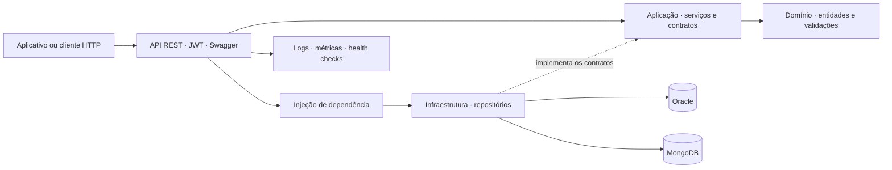

# Dobu — API .NET

**Cuidado que acompanha.**

O Dobu é um projeto de acompanhamento de animais à distância. A proposta é ajudar o tutor a manter os cuidados em dia e reunir as informações que acabam espalhadas entre anotações, comprovantes de vacinação e conversas sobre consultas.

Este repositório contém a API desenvolvida para a 4ª sprint de **Advanced Business Development with .NET**. É por ela que o aplicativo cadastra os animais, consulta seus registros, organiza a agenda e troca mensagens entre responsável e veterinário. Também é aqui que ficam armazenadas as observações recebidas da Dobu-Cam.

O aplicativo mobile e o serviço que captura e analisa as imagens da câmera são projetos separados. A API mantém os dados e oferece as rotas usadas nessas integrações.

Projetos relacionados: [aplicativo mobile](https://github.com/DobuChallenge/Dobu-FinalSprint4) e [serviço Dobu-Cam](https://github.com/DobuChallenge/Dobu-Cam).

## Integrantes

| Nome | RM |
| --- | --- |
| Amandha Yumi Toyota Artulino | 563549 |
| Erick Takeshi Andrade Nakajune | 566059 |
| Giovanna Bardella Gomes | 561439 |

## O que o Dobu reúne

O ponto de partida é o cadastro do responsável e do animal. Cada pet fica associado à sua raça, espécie e tutor. A partir desse cadastro, é possível organizar consultas, agendamentos, vacinas, lembretes e anotações de cuidado.

A agenda e a consulta têm funções diferentes. O agendamento organiza a data e permite que tutor e veterinário conversem para combinar o atendimento. A consulta reúne os dados do atendimento e pode ter prontuário, pagamento e análise associados.

No caderno de cuidados ficam as observações sobre o animal. As vacinas têm registro de aplicação e próxima dose, quando informada. Esses dados podem ser consultados pelo aplicativo para acompanhar a rotina e preparar o próximo atendimento.

A Dobu-Cam acrescenta o acompanhamento à distância. Uma câmera é cadastrada para um animal, e suas observações podem ser enviadas para o histórico. Presença, movimento, possível alimentação, hidratação e descanso são tipos de observação aceitos pela API. A captura e a identificação visual acontecem no serviço de câmera; o backend recebe e armazena o resultado. Essas observações são um apoio ao acompanhamento e não representam diagnóstico veterinário.

As funcionalidades disponíveis são:

- Cadastro e login de responsáveis e veterinários.
- Cadastro, consulta, edição e exclusão de animais, espécies e raças.
- Agenda de atendimentos, conversa e confirmação pelos dois participantes.
- Consultas, prontuários, vacinas, lembretes e caderno de cuidados.
- Registro de pagamentos e análises vinculadas ao atendimento.
- Cadastro de câmeras e histórico de observações no MongoDB.
- Registro e consulta de erros da aplicação.
- Filtros, pesquisa, ordenação, paginação e links de navegação nas consultas da API.

## Um exemplo de uso

Um tutor cadastra sua conta e registra a Lua como seu animal. Depois, escolhe um veterinário e cria um agendamento. Os dois podem conversar na página desse atendimento e confirmar se conseguem comparecer. Quando ambos confirmam, o status passa para `CONFIRMADO`.

O atendimento pode ser registrado como consulta, com prontuário e demais informações relacionadas. Entre uma consulta e outra, o tutor mantém as vacinas e as anotações de cuidado atualizadas. Se houver uma Dobu-Cam cadastrada para a Lua, as observações recebidas dessa câmera ficam em um histórico próprio.

Esse percurso relaciona os módulos do projeto: o animal pertence a um responsável; os atendimentos usam esse cadastro; os registros de saúde se vinculam ao animal ou à consulta; e a câmera também é associada ao pet.

## Tecnologias e bancos de dados

| Tecnologia | Uso no projeto |
| --- | --- |
| .NET 9 e ASP.NET Core | API HTTP, configuração, autenticação e injeção de dependência. |
| Entity Framework Core e Oracle | Persistência relacional, mapeamentos e migrações. |
| MongoDB e driver oficial | Histórico de observações das câmeras. |
| Swagger / OpenAPI | Documentação dos contratos e teste das rotas. |
| Serilog | Logs estruturados no console e em arquivo. |
| OpenTelemetry e Prometheus | Rastreamento de requisições e métricas. |
| xUnit, Moq e WebApplicationFactory | Testes unitários e de integração. |
| Coverlet | Coleta da cobertura de código. |

O **Oracle é o banco relacional da API, inclusive no desenvolvimento**. Nele ficam usuários, animais, catálogo de espécies e raças, atendimentos e os demais registros relacionados. A configuração SQL foi ajustada para Oracle 19c.

O **MongoDB guarda as observações da Dobu-Cam**. Cada documento identifica a câmera e o responsável, além do tipo de observação, descrição, data e confiança, quando informada. A API confere o vínculo da câmera com o tutor antes de permitir o acesso aos registros.

SQLite aparece apenas nos testes HTTP, em bases temporárias. A aplicação em execução não usa SQLite como alternativa ao Oracle.

## Organização do código

A solução está em `DOBU/Dobu.sln`. A separação das camadas segue Clean Architecture:

```text
DOBU/
├── Dobu.Domain/              Entidades e validações
├── Dobu.Application/         Serviços, DTOs e contratos
├── Dobu.Infrastructure/      Repositórios, mapeamentos e bancos
├── Dobu.Migrations.Oracle/   Migrações do esquema atual
├── Dobu.Api/                 Controllers e configuração da API
└── tests/
    ├── Dobu.UnitTests/
    └── Dobu.IntegrationTests/
```

O Domínio contém as entidades e suas validações. A Aplicação define os serviços e os contratos de que esses serviços precisam. A Infraestrutura implementa o acesso aos bancos. A API recebe as requisições, faz a configuração das dependências e devolve as respostas HTTP.

Por exemplo, `PetService` verifica a raça e o responsável antes de cadastrar um animal. Ele utiliza `IDobuUnitOfWork` e os contratos de repositório; a conexão e os comandos do Entity Framework ficam na Infraestrutura. O mesmo princípio é usado nos serviços de agendamento, conversa e observações da câmera.

`EntityRepository<T>` implementa as consultas e operações relacionais. `DobuUnitOfWork` reúne os repositórios e coordena a gravação das alterações. O histórico da câmera usa outro contrato, `ICameraObservationRepository`, implementado com o driver do MongoDB. Essas escolhas aplicam a responsabilidade única e a inversão de dependência de SOLID e permitem substituir os repositórios por mocks nos testes unitários.

As implementações são registradas na injeção de dependência. O tratamento de exceções não previstas fica no handler global da API, que registra a falha e retorna uma resposta com identificador de correlação.



## Executando o projeto

Os exemplos abaixo usam PowerShell e devem ser executados na raiz do repositório.

### 1. Preparar o ambiente

É necessário ter o .NET SDK 9, acesso a um Oracle 19c ou superior e um MongoDB 8 disponível. O serviço Dobu-Cam também precisa estar acessível para que a verificação de suas dependências fique saudável.

Docker é uma opção para iniciar os bancos localmente. Python 3 é usado apenas pelo script que consolida a cobertura, caso esse relatório seja executado fora do GitHub Actions.

```powershell
git clone https://github.com/DobuChallenge/Dobu-Sprint4.NET.git
Set-Location Dobu-Sprint4.NET

dotnet restore DOBU/Dobu.sln
dotnet tool restore
dotnet build DOBU/Dobu.sln
```

O manifesto em `.config/dotnet-tools.json` define a versão do `dotnet-ef` usada pelo projeto.

### 2. Informar a conexão Oracle

Para desenvolvimento, utilize o Secret Manager do .NET:

```powershell
dotnet user-secrets set "ConnectionStrings:DobuOracle" "User Id=SEU_USUARIO;Password=SUA_SENHA;Data Source=SEU_HOST:1521/SEU_SERVICO" --project DOBU/Dobu.Api
```

Substitua os campos pela conexão do seu banco. A API e a ferramenta de migrações leem essa mesma configuração, que fica fora do repositório.

As tabelas do projeto têm o prefixo `DOBU_`. O histórico das migrações fica em `DOBU_EF_MIGRATIONS`. Assim, o Dobu pode usar um schema compartilhado sem disputar nomes como `USUARIO` com outros projetos.

### 3. Informar MongoDB e Dobu-Cam

Em desenvolvimento, os valores definidos são:

| Configuração | Valor padrão |
| --- | --- |
| MongoDB | `mongodb://localhost:27017` |
| Banco MongoDB | `dobu` |
| Verificação do serviço Dobu-Cam | `http://localhost:5000/status` |

Se os serviços estiverem em outros endereços, configure as variáveis antes de iniciar a API:

```powershell
$env:Mongo__ConnectionString = 'mongodb://SEU_HOST:27017'
$env:Mongo__Database = 'dobu'
$env:Observability__ExternalServiceUrl = 'http://HOST_DOBU_CAM:5000/status'
```

A variável `Mongo__Enabled=true` inclui o MongoDB na verificação de saúde das dependências.

### 4. Aplicar as migrações

```powershell
dotnet ef database update --project DOBU/Dobu.Migrations.Oracle --startup-project DOBU/Dobu.Api
```

A API também aplica migrações pendentes na inicialização quando `Database__ApplyMigrations=true`. Para conferir o histórico:

```powershell
dotnet ef migrations list --project DOBU/Dobu.Migrations.Oracle --startup-project DOBU/Dobu.Api
```

O projeto `Dobu.Migrations.Oracle` mantém o esquema atual com as tabelas `DOBU_`. As migrações anteriores continuam em `Dobu.Infrastructure/Migrations`, preservadas como histórico das sprints. O [script Oracle idempotente](docs/oracle-migrations.sql) permite consultar os comandos que criam e atualizam o esquema atual.

### 5. Iniciar a API

```powershell
dotnet run --project DOBU/Dobu.Api --urls http://localhost:5100
```

Com a aplicação em execução, estes endereços ficam disponíveis:

| Endereço | Uso |
| --- | --- |
| [Swagger](http://localhost:5100/swagger) | Consultar e testar os endpoints. |
| [/health](http://localhost:5100/health) | Verificar se a API está respondendo. |
| [/health/ready](http://localhost:5100/health/ready) | Conferir a conexão com as dependências. |
| [/metrics](http://localhost:5100/metrics) | Consultar as métricas no formato Prometheus. |

Para acessar a API pelo celular, configure no aplicativo o endereço de rede do computador que está executando o backend. No celular, `localhost` se refere ao próprio aparelho.

### Alternativa: iniciar os bancos com Docker

O `compose.yml` oferece um Oracle e um MongoDB locais. Antes de executar, defina as senhas dos usuários Oracle:

```powershell
$env:ORACLE_ADMIN_PASSWORD = 'SUA_SENHA_ADMIN_LOCAL'
$env:DOBU_ORACLE_PASSWORD = 'SUA_SENHA_DO_USUARIO_LOCAL'
docker compose up -d
```

Para esse Oracle, a conexão é:

```text
User Id=dobu;Password=SUA_SENHA_DO_USUARIO_LOCAL;Data Source=localhost:1521/FREEPDB1
```

Cadastre essa conexão no Secret Manager, como no passo 2. Os bancos usam volumes persistentes e publicam as portas somente em `127.0.0.1`. O Compose inicia os bancos; a API é iniciada pelo comando `dotnet run` mostrado acima.

### Configuração em produção

Em outro ambiente, forneça a conexão e a chave JWT por variáveis de ambiente ou pelo armazenamento de segredos da hospedagem:

```text
ASPNETCORE_ENVIRONMENT=Production
Database__Provider=Oracle
Database__ApplyMigrations=true
ConnectionStrings__DobuOracle=<CONEXAO_ORACLE>
Jwt__Key=<CHAVE_COM_PELO_MENOS_32_CARACTERES>
Mongo__Enabled=true
Mongo__ConnectionString=<CONEXAO_MONGODB>
Mongo__Database=dobu
Observability__ExternalServiceUrl=<URL_DO_SERVICO_DOBU_CAM>/status
```

As variáveis de ambiente têm precedência sobre os segredos locais. A chave presente na configuração de desenvolvimento serve apenas para esse ambiente; em produção, é necessário informar outra chave.

## Primeiro acesso e autenticação

A API trabalha com dois perfis: `RESPONSAVEL` e `VETERINARIO`. Para começar pelo Swagger, abra `POST /api/auth/register`, clique em **Try it out** e preencha os dados da conta.

```json
{
  "nome": "Ana Responsável",
  "email": "ana@example.com",
  "senha": "SenhaDeExemplo123",
  "tipoUsuario": "RESPONSAVEL"
}
```

Para cadastrar o veterinário, use `VETERINARIO` no campo `tipoUsuario`. Depois, faça login em `POST /api/auth/login`:

```json
{
  "email": "ana@example.com",
  "senha": "SenhaDeExemplo123"
}
```

A resposta inclui o token e a identificação da conta. No Swagger, clique em **Authorize** e informe o token. Em outros clientes HTTP, envie o cabeçalho:

```http
Authorization: Bearer <TOKEN_RECEBIDO_NO_LOGIN>
```

As senhas são armazenadas como hash. Cadastro e login podem ser acessados sem token; as demais consultas e operações de negócio exigem autenticação. A alteração e a exclusão de uma conta são restritas ao próprio usuário.

Na conversa do agendamento, o acesso é conferido pelo vínculo do tutor com o animal ou pela participação do veterinário no atendimento. Para as observações da câmera, a API verifica se o animal pertence ao responsável autenticado.

## Rotas da API

A tabela mostra os recursos disponíveis. Nos recursos com CRUD, as operações são listagem, consulta por identificação, criação, atualização e exclusão. Os caminhos completos, campos obrigatórios e modelos das respostas podem ser consultados no Swagger ou em [docs/openapi.json](docs/openapi.json).

| Recurso | Rota base | Operações e consultas |
| --- | --- | --- |
| Autenticação | `/api/auth` | Cadastro e login por `POST`. |
| Usuários | `/api/usuarios` | CRUD; consultas por tipo e e-mail. |
| Espécies | `/api/especies` | CRUD; busca por nome. |
| Raças | `/api/racas` | CRUD; filtros por espécie e porte. |
| Animais | `/api/pets` | CRUD; filtros por responsável, raça e nome. |
| Consultas | `/api/consultas` | CRUD; filtros por animal, veterinário e período. |
| Agendamentos | `/api/agendamentos` | CRUD; filtros por animal, veterinário e status. |
| Conversa | `/api/agendamentos/{agendamentoId}/chat` | `GET` para listar e `POST` para enviar mensagens ou confirmar presença. |
| Prontuários | `/api/prontuarios` | CRUD; consulta por atendimento. |
| Vacinas | `/api/vacinas` | CRUD; consultas por animal e próxima dose. |
| Caderno de cuidados | `/api/informacoes-cuidado` | `GET` por animal, `POST` para registrar e `DELETE` por identificação. |
| Pagamentos | `/api/pagamentos` | CRUD; consulta por atendimento. |
| Lembretes | `/api/lembretes` | CRUD; consultas por animal e status. |
| Câmeras | `/api/dobucams` | CRUD; consultas por animal e status da câmera. |
| Observações | `/api/dobucams/{cameraId}/eventos` | Inserção, listagem, consulta individual e exclusão no MongoDB. |
| Análises | `/api/analises-ia` | CRUD; consultas por prontuário e risco. |
| Logs de erro | `/api/logs-erro` | CRUD; consultas por usuário e procedimento. |

Os identificadores retornados nas criações devem ser usados nas operações seguintes. Por exemplo, ao cadastrar um pet, informe uma raça existente e a identificação de uma conta do tipo `RESPONSAVEL`.

### Pesquisa, ordenação e paginação

As listagens permitem combinar parâmetros de consulta. Para procurar animais com determinado nome e receber a primeira página:

```http
GET /api/pets?page=1&pageSize=20&sort=nome&search=lua
```

Para consultar agendamentos confirmados, começando pelos mais recentes:

```http
GET /api/agendamentos?page=1&pageSize=10&status=CONFIRMADO&descending=true
```

`page` começa em 1. O tamanho da página pode variar de 1 a 100 registros; se apenas `page` for informado, são usados 20. Quando `page` e `pageSize` são omitidos, a API mantém a lista completa para compatibilidade com o aplicativo.

O parâmetro `sort` aceita campos escalares da entidade, exceto senha. A ordenação padrão é por data de criação, com o identificador como desempate. `descending=true` inverte a ordenação principal. `search` procura nos campos de texto sem pesquisar senhas. Os filtros `petId`, `responsavelId` e `veterinarioId` são aceitos nos recursos que possuem esses campos.

A paginação e os filtros são aplicados no banco antes de os registros serem retornados.

### Navegação HATEOAS

As respostas de consulta incluem links no cabeçalho HTTP `Link`. O cliente pode usar essas relações para abrir o próprio recurso, voltar à coleção e percorrer as páginas.

Em uma consulta paginada, os cabeçalhos podem conter:

```http
X-Total-Count: 5
Link: <http://localhost:5100/api/pets?page=1&pageSize=2>; rel="self", <http://localhost:5100/api/pets?page=2&pageSize=2>; rel="next"
```

`X-Total-Count` informa quantos registros correspondem aos filtros antes da paginação. As relações disponíveis incluem `self`, `collection`, `first`, `last`, `prev` e `next`, conforme a consulta. O corpo continua sendo um array, no formato utilizado pelo aplicativo.

### Conversa e confirmação do atendimento

O tutor e o veterinário enviam mensagens por `POST /api/agendamentos/{agendamentoId}/chat`:

```json
{
  "texto": "Podemos confirmar esse horário?",
  "tipo": "MENSAGEM"
}
```

Para confirmar presença, cada participante envia:

```json
{
  "texto": "",
  "tipo": "CONFIRMACAO"
}
```

A confirmação recebe um texto definido pelo serviço. Quando os dois participantes confirmam, o agendamento passa para `CONFIRMADO`. Se a mesma pessoa confirmar novamente, a API retorna a confirmação existente em vez de criar outra mensagem.

### Histórico de observações da Dobu-Cam

Uma observação é enviada para `POST /api/dobucams/{cameraId}/eventos`:

```json
{
  "tipo": "HIDRATACAO",
  "descricao": "Possível interação junto ao pote de água",
  "data": "2026-11-04T12:30:00Z",
  "confianca": 0.8
}
```

A câmera precisa estar cadastrada e vinculada ao animal do responsável autenticado. Os tipos aceitos são `PRESENCA`, `MOVIMENTO`, `ALIMENTACAO`, `HIDRATACAO` e `DESCANSO`. A confiança é opcional e, quando enviada, deve estar entre 0 e 1.

O histórico permite filtrar por `tipo`, pesquisar a descrição e paginar os resultados. A ordenação usa `timestamp` e pode ser invertida com `descending=true`. Os registros ficam no MongoDB, separados dos dados relacionais do atendimento.

## Monitoramento e tratamento de erros

A API oferece três pontos de consulta para acompanhar sua execução:

| Rota | O que verifica |
| --- | --- |
| `GET /health` | Se a API está respondendo. |
| `GET /health/ready` | Acesso ao banco relacional, ao MongoDB e ao serviço externo configurado. |
| `GET /metrics` | Métricas de requisições, duração das respostas e erros HTTP. |

A verificação de dependências retorna 200 quando os serviços estão saudáveis e 503 quando alguma dependência está indisponível. Se o Swagger abrir, mas `/health/ready` responder 503, o resultado dessa rota indica qual dependência precisa ser conferida.

O Serilog envia logs estruturados ao console e a arquivos diários na pasta `logs` da aplicação. Cada requisição tem um identificador de correlação. O cliente pode informar `X-Correlation-ID`, e esse valor é devolvido na resposta e incluído nos logs. Isso ajuda a localizar o que aconteceu em uma operação específica.

OpenTelemetry registra o rastreamento das requisições e das chamadas HTTP. As métricas podem ser consultadas no formato Prometheus em `/metrics`.

Os principais códigos de resposta são:

| Código | Situação |
| --- | --- |
| 200 | Consulta ou atualização concluída. |
| 201 | Registro criado, com a localização do recurso na resposta. |
| 204 | Exclusão concluída, sem conteúdo no corpo. |
| 400 | Dados ou parâmetros de consulta inválidos. |
| 401 | Autenticação ausente ou inválida. |
| 403 | Operação não permitida para o usuário. |
| 404 | Registro não encontrado ou indisponível para aquele acesso. |
| 409 | Conflito com dados já cadastrados ou vínculos existentes. |
| 500 | Erro inesperado, com detalhes registrados nos logs do servidor. |
| 503 | Dependência indisponível. |

Exceções não previstas são registradas e convertidas pelo handler global em respostas `ProblemDetails`, acompanhadas de um identificador de correlação. Detalhes internos do servidor não são enviados ao cliente.

## Testes e cobertura

Os testes estão divididos entre `Dobu.UnitTests` e `Dobu.IntegrationTests`. Os unitários verificam validações e serviços com dependências controladas. Os de integração fazem requisições HTTP à API e percorrem os fluxos de cadastro, autenticação, animais, atendimentos e demais registros.

A organização segue AAA: primeiro são preparados os dados e as dependências; depois a operação é executada; por fim, o resultado é conferido. Há testes para paginação, HATEOAS, confirmação pelos dois participantes, isolamento das observações por responsável e persistência no MongoDB.

### Executar a suíte local

Com MongoDB disponível:

```powershell
$env:DOBU_TEST_MONGO_URL = 'mongodb://localhost:27017'
dotnet test DOBU/Dobu.sln
```

Cada execução dos testes HTTP usa um SQLite temporário. O teste MongoDB cria um banco próprio e o remove ao terminar. Esses testes não utilizam o banco Oracle configurado para o uso normal da API. Sem `DOBU_TEST_MONGO_URL`, o teste NoSQL é marcado como ignorado.

### Testar a persistência Oracle

O teste Oracle precisa de um schema exclusivo para testes, pois aplica as migrações antes de iniciar a transação de verificação:

```powershell
$env:DOBU_TEST_ORACLE = 'CONEXAO_DO_SCHEMA_EXCLUSIVO_DE_TESTES'
$env:DOBU_TEST_ORACLE_ISOLATED = 'true'
dotnet test DOBU/Dobu.sln --filter FullyQualifiedName~OraclePersistenceTests
```

Ele verifica o histórico de migrações, grava um registro, consulta esse registro e valida o rollback da transação. Sem as duas variáveis, esse teste é marcado como ignorado.

No GitHub Actions, o workflow inicia Oracle e MongoDB isolados para executar a suíte completa. Os resultados podem ser acompanhados em [Testes .NET](https://github.com/DobuChallenge/Dobu-Sprint4.NET/actions/workflows/dotnet.yml).

### Gerar o relatório de cobertura

```powershell
$resultados = Join-Path 'TestResults' ([guid]::NewGuid().ToString('N'))
dotnet test DOBU/Dobu.sln --collect:"XPlat Code Coverage" --results-directory $resultados
python scripts/coverage.py $resultados --minimum 80
```

O script reúne os relatórios por linha de código, combinando os testes unitários e de integração. O limite interno é de 80% por camada. A medição registrada em [docs/cobertura.json](docs/cobertura.json) é:

| Camada | Cobertura de linhas |
| --- | --- |
| Domínio | 89,46% |
| Aplicação | 91,86% |

O workflow também disponibiliza os arquivos de cobertura como artefatos de cada execução.

## Documentação complementar

A pasta `docs` reúne a especificação da API, o script Oracle, a cobertura e os materiais de modelagem do projeto:

- [Modelo relacional](docs/modelorelacional.png)
- [Diagrama entidade-relacionamento](docs/MER%20%28Entidade-Relacionamento%29.png)
- [Esquema físico](docs/esquemafisico.png)

Os diagramas relacionais das sprints anteriores foram mantidos como referência da modelagem. As migrações atuais incluem também o caderno de cuidados e as mensagens dos agendamentos.
