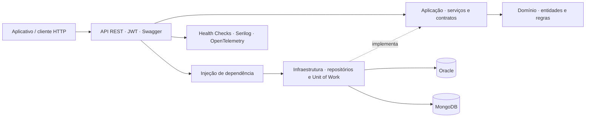

# DOBU API · Sprint 4

**Cuidado que acompanha.**

API do Dobu para cadastrar animais e organizar consultas, vacinas e registros de cuidados. Responsáveis e veterinários podem conversar sobre os agendamentos e consultar as informações do animal. As observações da Dobu-Cam ficam em um histórico separado.

## Integrantes

| Nome | RM |
| --- | --- |
| Amandha Yumi Toyota Artulino | 563549 |
| Erick Takeshi Andrade Nakajune | 566059 |
| Giovanna Bardella Gomes | 561439 |

## Funcionalidades

- Cadastro e autenticação de responsáveis e veterinários com JWT e senhas armazenadas como hash.
- Cadastro, consulta, edição e exclusão de animais, espécies e raças.
- Consultas, agendamentos e conversa entre os participantes do atendimento.
- Confirmação do agendamento pelo responsável e pelo veterinário.
- Prontuários, vacinas, lembretes e caderno de cuidados.
- Cadastro de câmeras e armazenamento de suas observações no MongoDB.
- Pagamentos, análises e registros de erro vinculados ao atendimento.
- Consultas com filtros, busca, ordenação, paginação e links HATEOAS.

A API recebe e armazena observações da câmera; a captura e a análise de imagens são executadas pelo serviço Dobu-Cam, em projeto separado. Uma observação de alimentação, hidratação ou descanso não representa diagnóstico veterinário.

## Tecnologias

.NET 9, ASP.NET Core, Entity Framework Core, Oracle Database, MongoDB, Swagger/OpenAPI, Serilog, OpenTelemetry, Prometheus, xUnit, Moq e Coverlet.

A API usa Oracle como banco relacional, inclusive no desenvolvimento, e MongoDB para as observações da câmera. SQLite é usado somente nas bases temporárias dos testes HTTP.

## Arquitetura

O projeto segue Clean Architecture. Os contratos e serviços ficam na Aplicação; os detalhes de banco de dados ficam na Infraestrutura.

| Projeto | Responsabilidade |
| --- | --- |
| `Dobu.Domain` | Entidades e validações do domínio. |
| `Dobu.Application` | Casos de uso, DTOs e contratos de repositórios. |
| `Dobu.Infrastructure` | Repositórios EF Core, Unit of Work, mapeamentos e acesso ao MongoDB. |
| `Dobu.Migrations.Oracle` | Migrações Oracle do esquema isolado do Dobu. |
| `Dobu.Api` | Controllers, autenticação, composição da DI, Swagger e observabilidade. |
| `tests` | Testes unitários e de integração. |



Os controllers utilizam contratos de repositórios. Os fluxos de pets, agendamentos, conversa e observações têm serviços na camada de Aplicação. A persistência fica na Infraestrutura, e o tratamento global de exceções usa respostas `ProblemDetails` com identificador de correlação.

## Instalação e execução

### Pré-requisitos

- .NET SDK 9.
- Oracle Database 19c ou superior, com permissão para criar tabelas no schema utilizado.
- MongoDB 8 acessível pela aplicação.
- Serviço Dobu-Cam, caso a integração de câmera seja utilizada.
- Python 3 apenas para consolidar os relatórios de cobertura.

Na raiz do repositório:

```powershell
dotnet restore DOBU/Dobu.sln
dotnet tool restore
dotnet build DOBU/Dobu.sln
```

### Configurar o Oracle

Em desenvolvimento, salve a conexão pelo Secret Manager do .NET:

```powershell
dotnet user-secrets set "ConnectionStrings:DobuOracle" "User Id=SEU_USUARIO;Password=SUA_SENHA;Data Source=SEU_HOST:1521/SEU_SERVICO" --project DOBU/Dobu.Api
```

O Secret Manager mantém o valor fora do repositório. A API e as ferramentas de migração leem a mesma configuração. Não publique senhas em arquivos versionados.

Em produção, utilize variáveis de ambiente ou o armazenamento de segredos da hospedagem:

```text
ASPNETCORE_ENVIRONMENT=Production
Database__Provider=Oracle
Database__ApplyMigrations=true
ConnectionStrings__DobuOracle=<CONEXAO_ORACLE>
Jwt__Key=<CHAVE_COM_PELO_MENOS_32_CARACTERES>
Mongo__Enabled=true
Mongo__ConnectionString=<CONEXAO_MONGODB>
Mongo__Database=dobu
Observability__ExternalServiceUrl=<URL_DO_SERVICO_DOBU_CAM>/status
```

A chave JWT de desenvolvimento é exclusiva desse ambiente. Configure uma chave própria em produção. As variáveis de ambiente têm precedência sobre os segredos locais.

### Configurar MongoDB e serviço externo

O ambiente de desenvolvimento usa `mongodb://localhost:27017`, banco `dobu`, e consulta o serviço Dobu-Cam em `http://localhost:5000/status`. Para outros endereços:

```powershell
$env:Mongo__ConnectionString = 'mongodb://SEU_HOST:27017'
$env:Mongo__Database = 'dobu'
$env:Observability__ExternalServiceUrl = 'http://HOST_DOBU_CAM:5000/status'
```

### Aplicar as migrações

```powershell
dotnet ef database update --project DOBU/Dobu.Migrations.Oracle --startup-project DOBU/Dobu.Api
```

A aplicação também verifica as migrações na inicialização quando `Database__ApplyMigrations=true`.

As tabelas relacionais usam o prefixo `DOBU_`, e o histórico é mantido em `DOBU_EF_MIGRATIONS`. Essa separação evita conflitos com outras aplicações que utilizem o mesmo schema. O script idempotente está em [docs/oracle-migrations.sql](docs/oracle-migrations.sql).

As migrações das sprints anteriores permanecem em `Dobu.Infrastructure/Migrations` como histórico do projeto. O esquema atual é mantido por `Dobu.Migrations.Oracle`.

### Iniciar a API

```powershell
dotnet run --project DOBU/Dobu.Api --urls http://localhost:5100
```

- Swagger: [http://localhost:5100/swagger](http://localhost:5100/swagger)
- Disponibilidade: [http://localhost:5100/health](http://localhost:5100/health)
- Dependências: [http://localhost:5100/health/ready](http://localhost:5100/health/ready)
- Métricas: [http://localhost:5100/metrics](http://localhost:5100/metrics)

Para usar o aplicativo em outro aparelho, informe o endereço de rede do computador que hospeda a API. `localhost` no celular aponta para o próprio celular.

### Bancos locais com Docker

Como alternativa a bancos já disponíveis, o `compose.yml` inicia Oracle e MongoDB com volumes persistentes:

```powershell
$env:ORACLE_ADMIN_PASSWORD = 'SUA_SENHA_ADMIN_LOCAL'
$env:DOBU_ORACLE_PASSWORD = 'SUA_SENHA_DO_USUARIO_LOCAL'
docker compose up -d
```

O Oracle local utiliza `User Id=dobu;Password=SUA_SENHA_DO_USUARIO_LOCAL;Data Source=localhost:1521/FREEPDB1`. As portas são publicadas somente em `127.0.0.1`.

## Autenticação e acesso

1. Cadastre uma conta em `POST /api/auth/register`.
2. Entre em `POST /api/auth/login`.
3. No Swagger, clique em **Authorize** e informe o token. Em clientes HTTP, envie `Authorization: Bearer <token>`.

```json
{
  "nome": "Ana Responsável",
  "email": "ana@example.com",
  "senha": "SenhaDeExemplo123",
  "tipoUsuario": "RESPONSAVEL"
}
```

Os perfis aceitos são `RESPONSAVEL` e `VETERINARIO`. Cadastro e login permitem acesso anônimo; os demais recursos de negócio exigem autenticação. A alteração e a exclusão de usuários são restritas ao próprio cadastro. A conversa só pode ser acessada pelos participantes do agendamento; as observações da câmera, pelo responsável do animal.

## Endpoints

A especificação completa, com parâmetros e schemas de entrada e saída, está em [docs/openapi.json](docs/openapi.json) e no Swagger da aplicação.

| Recurso | Rota base | Operações |
| --- | --- | --- |
| Autenticação | `/api/auth` | Cadastro e login. |
| Usuários | `/api/usuarios` | Cadastro, consulta, edição e exclusão. |
| Espécies | `/api/especies` | CRUD e filtro por nome. |
| Raças | `/api/racas` | CRUD e filtros por espécie e porte. |
| Animais | `/api/pets` | CRUD e filtros por responsável, raça e nome. |
| Consultas | `/api/consultas` | CRUD e filtros por animal, veterinário e período. |
| Agendamentos | `/api/agendamentos` | CRUD e filtros por animal, veterinário e status. |
| Conversa | `/api/agendamentos/{agendamentoId}/chat` | Listagem, mensagens e confirmações. |
| Prontuários | `/api/prontuarios` | CRUD e consulta por atendimento. |
| Vacinas | `/api/vacinas` | CRUD e consultas por animal e próxima dose. |
| Caderno de cuidados | `/api/informacoes-cuidado` | Registro, consulta por animal e exclusão. |
| Pagamentos | `/api/pagamentos` | CRUD e consulta por atendimento. |
| Lembretes | `/api/lembretes` | CRUD e consultas por animal e status. |
| Câmeras | `/api/dobucams` | CRUD e consultas por animal e status. |
| Observações | `/api/dobucams/{cameraId}/eventos` | Inserção, listagem, consulta individual e exclusão no MongoDB. |
| Análises | `/api/analises-ia` | CRUD e consultas por prontuário e risco. |
| Logs de erro | `/api/logs-erro` | CRUD dos registros de erro. |

### Paginação, filtros e HATEOAS

```http
GET /api/pets?page=1&pageSize=20&sort=nome&search=lua
GET /api/agendamentos?page=1&pageSize=10&status=CONFIRMADO&descending=true
```

- `page` começa em 1; `pageSize` aceita de 1 a 100 e usa 20 quando omitido junto de `page`.
- `sort` aceita campos escalares públicos da entidade, exceto senha. `descending=true` inverte a ordenação.
- `search` pesquisa campos de texto. Filtros `petId`, `responsavelId` e `veterinarioId` são aceitos quando existem na entidade consultada.
- Sem `page` e `pageSize`, a lista completa é preservada para compatibilidade com o aplicativo.
- A resposta permanece um array. `X-Total-Count` informa o total filtrado, e `Link` fornece relações HATEOAS como `self`, `collection`, `first`, `last`, `prev` e `next`.

### Confirmação de agendamentos

Envie uma mensagem pelo `POST /api/agendamentos/{agendamentoId}/chat`, com `texto` e `tipo: "MENSAGEM"`. Para confirmar presença, envie `tipo: "CONFIRMACAO"`. Após a confirmação dos dois participantes, o agendamento recebe status `CONFIRMADO`. Repetir a confirmação do mesmo participante não cria outra mensagem.

### Observações da câmera

O endpoint `POST /api/dobucams/{cameraId}/eventos` recebe:

```json
{
  "tipo": "HIDRATACAO",
  "descricao": "Possível interação junto ao pote de água",
  "data": "2026-11-04T12:30:00Z",
  "confianca": 0.8
}
```

Tipos aceitos: `PRESENCA`, `MOVIMENTO`, `ALIMENTACAO`, `HIDRATACAO` e `DESCANSO`. Confiança é opcional, entre 0 e 1. A listagem permite filtrar por `tipo`, pesquisar a descrição e paginar. A ordenação usa `timestamp`, com opção `descending=true`.

## Monitoramento e respostas HTTP

`/health` verifica a disponibilidade da API. `/health/ready` verifica o banco relacional, o MongoDB e o serviço externo configurado, retornando 200 quando estão saudáveis e 503 quando uma dependência está indisponível.

Os logs estruturados são enviados ao console e a arquivos diários em `logs`. O cabeçalho `X-Correlation-ID` permite relacionar uma resposta aos logs da requisição. OpenTelemetry fornece tracing e métricas, expostas em `/metrics` no formato Prometheus.

A API utiliza 200 para consultas e atualizações, 201 para criação com localização do recurso e 204 para exclusão. Erros de validação retornam 400; falhas de autenticação, 401; acesso negado, 403; registros não encontrados, 404; conflitos de persistência, 409. Exceções não tratadas são convertidas pelo handler global em respostas `ProblemDetails`, sem expor detalhes internos do servidor.

## Testes

Os testes unitários e de integração usam xUnit e organização AAA: preparação, execução e verificação. A suíte cobre autenticação, validações, CRUDs, paginação, HATEOAS, confirmação de agendamento e persistência NoSQL.

```powershell
$env:DOBU_TEST_MONGO_URL = 'mongodb://localhost:27017'
$resultados = Join-Path 'TestResults' ([guid]::NewGuid().ToString('N'))
dotnet test DOBU/Dobu.sln --collect:"XPlat Code Coverage" --results-directory $resultados
python scripts/coverage.py $resultados --minimum 80
```

Os testes HTTP utilizam um SQLite temporário por execução, sem alterar o Oracle configurado na API. Os testes MongoDB utilizam um banco exclusivo e removem seus dados ao terminar. Sem `DOBU_TEST_MONGO_URL`, o teste NoSQL é identificado como ignorado.

Para validar migrações e persistência Oracle, use exclusivamente um schema de testes:

```powershell
$env:DOBU_TEST_ORACLE = 'CONEXAO_DO_SCHEMA_EXCLUSIVO_DE_TESTES'
$env:DOBU_TEST_ORACLE_ISOLATED = 'true'
dotnet test DOBU/Dobu.sln --filter FullyQualifiedName~OraclePersistenceTests
```

Esse teste aplica as migrações e faz rollback dos registros criados durante a verificação. O workflow do GitHub Actions prepara Oracle e MongoDB isolados para executar a suíte completa e disponibiliza os relatórios de cobertura como artefatos.

O limite interno de cobertura é 80% por camada. A medição consolidada de referência é **89,46% em Domínio** e **91,86% em Aplicação**, registrada em [docs/cobertura.json](docs/cobertura.json). Consulte as execuções e seus relatórios em [GitHub Actions](https://github.com/DobuChallenge/Dobu-Sprint4.NET/actions).

## Modelagem e documentação
- [Modelo relacional](docs/modelorelacional.png)
- [Diagrama entidade-relacionamento](docs/MER%20%28Entidade-Relacionamento%29.png)
- [Esquema físico](docs/esquemafisico.png)

Os diagramas relacionais das sprints anteriores foram preservados. As migrações atuais incluem também o caderno de cuidados e as mensagens dos agendamentos.
